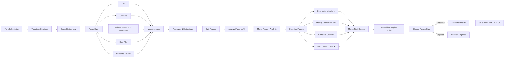

# Architecture

## System Overview

Research Intelligence n8n is a modular, self-hostable academic research automation system built on n8n. It follows an evidence-first pipeline: search → retrieve → deduplicate → analyze → synthesize → human review → report.

---

## Node Descriptions

### Input & Validation
| Node | Purpose |
|------|---------|
| On form submission | Web form trigger. Collects topic, discipline, depth, citation format, date range, language. |
| Validate & Configure | Validates input, generates research_id, sets config defaults. Throws user-friendly errors for invalid input. |

### Query Refinement
| Node | Purpose |
|------|---------|
| Refine Research Query | Calls configured LLM to generate 8 structured search queries from the topic. |
| Parse Query Output | Extracts JSON from LLM response. Falls back gracefully if LLM fails. |

### Multi-Source Retrieval (5 sources, all free)
| Node | API | Auth |
|------|-----|------|
| ArXiv Search | export.arxiv.org | None |
| CrossRef Search | api.crossref.org | None (email improves rate limit) |
| PubMed esearch | eutils.ncbi.nlm.nih.gov/esearch | None (API key improves rate limit) |
| PubMed eSummary | eutils.ncbi.nlm.nih.gov/esummary | None (chains from esearch IDs) |
| OpenAlex Search | api.openalex.org | None |
| Semantic Scholar Search | api.semanticscholar.org | Optional free API key |

### Processing
| Node | Purpose |
|------|---------|
| Merge Sources | Combines all 5 source streams. |
| Aggregate & Deduplicate | Normalizes all sources to common schema. Deduplicates by DOI first, then normalized title. Sorts by citations desc. |
| Split Papers | Splits paper array into individual items for parallel processing. |
| Analyze Paper | Calls LLM for each paper. Includes paper_id in prompt for reliable matching. Batched 3 at a time. |
| Merge Paper + Analysis | Combines paper metadata with LLM analysis. Uses pairedItem + ID matching for reliability. |
| Collect All Analyzed Papers | Aggregates all processed papers. |

### Synthesis
| Node | Purpose |
|------|---------|
| Synthesize Literature | Calls LLM to produce thematic synthesis across all papers. |
| Identify Research Gaps | Calls LLM to categorize research gaps (empirical, theoretical, methodological, contextual, temporal). |
| Generate Citations | Calls LLM to format citations in the requested style (APA/Harvard/IEEE/Chicago/Vancouver). |
| Build Literature Matrix | Calls LLM to produce structured comparative matrix. |

### Output
| Node | Purpose |
|------|---------|
| Merge Final Outputs | Combines all 4 synthesis outputs. |
| Assemble Complete Review Data | Builds final data structure with all components, AI disclosure, and fallbacks. |
| Human Review Gate | Wait node — pauses workflow. Researcher reviews draft before final report. |
| Check Approval Status | Branches on approval/rejection. |
| Generate HTML/Markdown/JSON Report | Three separate report generators. |
| Save * Report | Writes files to OUTPUT_DIR. |

---

## Data Flow Schemas

All data schemas are in `/schemas/`:
- `research-input.schema.json` — form submission
- `source.schema.json` — normalized paper record
- `evidence.schema.json` — extracted evidence record
- `research-output.schema.json` — final output

---

## LLM Provider Configuration

All LLM calls use a single configurable OpenAI-compatible endpoint. Set via environment variables:

| Variable | Default | Description |
|----------|---------|-------------|
| `LLM_API_BASE_URL` | `https://openrouter.ai/api/v1` | Any OpenAI-compatible base URL |
| `LLM_API_KEY` | _(required)_ | API key (use `ollama` for local Ollama) |
| `LLM_MODEL` | `meta-llama/llama-3.2-3b-instruct:free` | Model identifier |
| `LLM_MAX_TOKENS` | `4096` | Max tokens per request |
| `LLM_TEMPERATURE` | `0.3` | Temperature |

**Provider examples:**

| Provider | Base URL | Model example | Cost |
|----------|---------|--------------|------|
| OpenRouter (free models) | `https://openrouter.ai/api/v1` | `meta-llama/llama-3.2-3b-instruct:free` | Free (rate limited) |
| Ollama (local) | `http://ollama:11434/v1` | `llama3.2:3b` | Free (hardware cost) |
| Groq | `https://api.groq.com/openai/v1` | `llama-3.1-8b-instant` | Free tier available |
| Gemini | `https://generativelanguage.googleapis.com/v1beta/openai/v1` | `gemini-2.0-flash` | Free tier available |
| OpenAI | `https://api.openai.com/v1` | `gpt-4o-mini` | Paid |

---

## Academic Database Integrations

| Database | URL | Rate Limit | Auth | What it provides |
|----------|-----|------------|------|-----------------|
| ArXiv | export.arxiv.org | Polite use | None | Preprints, STEM focus, full-text PDFs for all papers |
| CrossRef | api.crossref.org | Polite Pool: unlimited; standard: 50 req/sec | Email (improves limits) | Published papers, DOIs, citations, metadata |
| PubMed | eutils.ncbi.nlm.nih.gov | 3 req/sec without key; 10 req/sec with key | NCBI API key (free) | Biomedical literature, MeSH terms |
| OpenAlex | api.openalex.org | 100,000 req/day | None | Open scholarly metadata, inverted index abstracts |
| Semantic Scholar | api.semanticscholar.org | 100 req/5min without key; 1 req/sec with key | Free API key | Paper graph, citations, open access PDFs |

---

## Storage Options

### Default: Filesystem
Reports are saved to `OUTPUT_DIR` (default: `/output`).  
Files per research run: `{research_id}_review.html`, `{research_id}_review.md`, `{research_id}_data.json`.

### Optional: PostgreSQL
Set `POSTGRES_*` environment variables to store research data in PostgreSQL. Requires a custom storage workflow (not included in v2.0.0).

---

## Security Model

1. **API keys:** All API keys are environment variables only. No key is stored in workflow JSON.
2. **n8n encryption:** All credentials stored in n8n are encrypted with `N8N_ENCRYPTION_KEY`. This key must be set before first run.
3. **Network isolation:** All services run in an internal Docker network. Only n8n port 5678 is exposed.
4. **Input validation:** Research topic is validated for length and character set before entering LLM prompts.
5. **Prompt injection:** Retrieved paper content is treated as untrusted data and embedded in structured prompts, not as instructions.
6. **PDF processing:** The document processor service runs as a non-root user. PDFs are processed in memory only — not stored.
7. **Authentication:** n8n basic auth is enabled by default. Change the default credentials before deployment.

---

## Design Decisions

### Why HTTP requests instead of LangChain agent nodes?
LangChain agent nodes in n8n bind credentials to the n8n instance at import time. Exporting and re-importing a workflow with LangChain agent nodes requires re-configuring credentials in the new instance's UI. Using direct HTTP requests with environment variable expressions (`$env.LLM_API_KEY`) means the workflow is portable: set the environment variables and the workflow works without touching the n8n UI.

### Why remove Airtable?
Airtable requires a paid account for most production use cases, embeds instance-specific base and table IDs in the workflow JSON (breaking portability), and sends research data to a third-party SaaS platform. Filesystem output is universally available, free, and keeps data under the researcher's control.

### Why not microservices?
Two products on a small team cannot afford a service mesh. The document processor is a single service — not a distributed system. n8n is the orchestrator.

### Why no Semantic Scholar scraping?
The Semantic Scholar Public API (api.semanticscholar.org/graph/v1) is free, documented, and explicitly supports programmatic access. The original workflow referenced Semantic Scholar but had no actual nodes — this version adds real integration via the official API.
