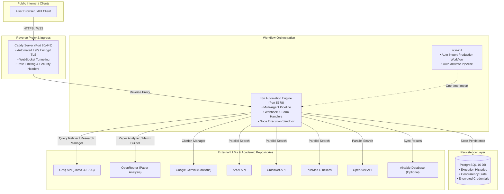

# Production Deployment & Operations Guide

This guide provides end-to-end instructions for deploying and running the **Agentic Literature Survey Workflow** in a production environment.

---

## 1. System Architecture

In production, the workflow runs on an enterprise-grade containerized architecture designed for high availability, security, persistence, and execution resilience:



---

## 2. Hardware & Infrastructure Prerequisites

### Recommended Server Specifications
- **Operating System:** Linux (Ubuntu 22.04 LTS+, Debian 12, RHEL 9) or macOS
- **CPU:** 2 vCPUs minimum (4 vCPUs recommended for concurrent review synthesis)
- **Memory (RAM):** 4 GB RAM minimum (8 GB recommended for PostgreSQL execution caching)
- **Disk Storage:** 20 GB SSD storage minimum
- **Network:** Outbound HTTPS access to academic APIs and LLM providers; open inbound ports 80 & 443 for public access.

### Software Requirements
- **Docker Engine:** Version 24.0.0 or higher
- **Docker Compose:** Version 2.20.0 or higher
- **Node.js (Optional, for standalone CLI/API runner):** v18.0.0 or higher

---

## 3. Quick Start: Single-Command Production Deployment

### Step 1: Clone and Enter the Repository
```bash
git clone https://github.com/nidhi-shree/agentic-literature-survey-workflow.git
cd agentic-literature-survey-workflow
```

### Step 2: Configure Environment Variables
Copy the production environment template:
```bash
cp .env.example .env
```

Open `.env` in your editor and configure:
1. `DOMAIN_NAME`: Your public server domain (e.g., `survey.yourdomain.com`) or `localhost`.
2. `GROQ_API_KEY`: API key from [Groq Console](https://console.groq.com/keys) (used by Research Manager).
3. `OPENROUTER_API_KEY`: API key from [OpenRouter](https://openrouter.ai/keys) (used by Paper Analyzer & Matrix Builder).
4. `GEMINI_API_KEY`: API key from [Google AI Studio](https://aistudio.google.com/app/apikey) (used by Citation Manager).
5. `POSTGRES_PASSWORD`: A secure random password for the internal PostgreSQL database.

### Step 3: Run the Automated Deployment Script
```bash
./scripts/deploy.sh
# or using Make:
make deploy
```

The script automatically:
- Validates Docker and Docker Compose availability.
- Generates a secure random 32-character encryption key (`N8N_ENCRYPTION_KEY`) if not present.
- Launches PostgreSQL 16, n8n, and Caddy containers.
- Waits for database and n8n healthchecks to pass.
- Auto-imports the parameterized production workflow into n8n and activates it.

---

## 4. Environment Variables Reference

| Variable | Required | Default / Example | Purpose |
| :--- | :---: | :--- | :--- |
| `DOMAIN_NAME` | **Yes** | `survey.yourdomain.com` | Public domain for automated SSL certificates via Caddy. |
| `N8N_PROTOCOL` | **Yes** | `https` | Protocol for webhooks (`https` in production, `http` for local). |
| `WEBHOOK_URL` | **Yes** | `https://survey.yourdomain.com` | The base URL advertised to clients for webhooks and form submissions. |
| `POSTGRES_USER` | **Yes** | `n8n_prod` | Internal PostgreSQL database username. |
| `POSTGRES_PASSWORD` | **Yes** | *(Secure Random String)* | Database authentication password. |
| `POSTGRES_DB` | **Yes** | `n8n_survey_db` | n8n state and execution database name. |
| `N8N_ENCRYPTION_KEY` | **Yes** | *(32-char Hex String)* | Master key used to encrypt credentials stored in n8n. |
| `GROQ_API_KEY` | **Yes** | `gsk_...` | High-speed LLM inference for Query Refiner & Research Manager. |
| `OPENROUTER_API_KEY`| **Yes** | `sk-or-v1-...` | LLM router for Paper Analyzer & Literature Matrix. |
| `GEMINI_API_KEY` | **Yes** | `AIza...` | Google Gemini API key for IEEE Citation Manager. |
| `OPENAI_API_KEY` | *Optional* | `sk-...` | Fallback model provider. |
| `AIRTABLE_API_KEY` | *Optional* | `pat_...` | Optional personal access token for storing output records in Airtable. |
| `AIRTABLE_BASE_ID` | *Optional* | `app...` | Target Airtable Base ID. |
| `AIRTABLE_TABLE_NAME`| *Optional* | `Literature_Reviews` | Target Airtable Table Name. |

---

## 5. Running the Workflow in Production

### Method A: Interactive Web Form (For End Users)
1. Open your browser and navigate to:
   ```
   https://<YOUR_DOMAIN>/form/
   ```
   *(or `http://localhost:5678/form/` if testing locally)*
2. Input the research topic (e.g., `EEG Seizure Prediction using Deep Learning` or `Graph Neural Networks for Drug Discovery`).
3. Click **Submit**.
4. The agent pipeline executes:
   - Queries ArXiv, CrossRef, PubMed, and OpenAlex in parallel.
   - Deduplicates and ranks the top publications.
   - Analyzes each paper with specialized LLM prompts.
   - Generates a synthesized IEEE-formatted Literature Review document.
5. The final HTML publication document is returned for direct view and download.

### Method B: Headless Standalone CLI
You can execute literature reviews directly from the terminal without launching n8n:
```bash
# Run via npm
npm run survey -- "EEG Seizure Prediction using Deep Learning"

# Or via node directly
node runner/cli.js "Multimodal Foundation Models in Pathology"
```
Generated reports are saved directly to `./output/`:
- `output/survey_<topic>_<timestamp>.html` (Full IEEE publication layout)
- `output/matrix_<topic>_<timestamp>.json` (Structured literature comparison dataset)

### Method C: Standalone REST API Microservice
Start the lightweight production REST API server:
```bash
npm run start:runner
# or: node runner/server.js
```
The server exposes:
- `POST http://localhost:3000/api/survey` - Accepts `{"topic": "Your Topic"}` and returns structured review JSON + HTML.
- `GET http://localhost:3000/api/health` - Healthcheck probe for load balancers.
- `GET http://localhost:3000/` - Interactive web dashboard.

---

## 6. Operations, Monitoring & Maintenance

### Checking Service Health
Run the automated healthcheck script:
```bash
./scripts/healthcheck.sh
# or
make health
```

### Inspecting Live Logs
```bash
# Stream n8n logs
docker compose logs -f n8n

# Stream PostgreSQL logs
docker compose logs -f postgres

# Stream Caddy logs
docker compose logs -f caddy
```

### Automated Database & Workflow Backups
Run the backup script to generate a timestamped `.tar.gz` archive containing PostgreSQL dumps and exported n8n workflows:
```bash
./scripts/backup.sh
# or
make backup
```
Backups are saved to `./backups/backup_<timestamp>.tar.gz`.

### Upgrading Services
To update n8n or database containers to the latest images:
```bash
docker compose pull
docker compose up -d
```

### Stopping Services
```bash
docker compose down
# or
make down
```

---

## 7. Troubleshooting & Production FAQ

### Q: Why do search queries take 30–60 seconds?
**A:** The workflow queries 4 independent academic APIs (ArXiv, CrossRef, PubMed, OpenAlex) in parallel, normalizes and deduplicates up to 60 candidate papers, and then sends batches of papers through the Paper Analyzer LLM agent before synthesizing the comprehensive IEEE review document. This thorough multi-agent analysis is designed for publication-grade output.

### Q: What if an academic API rate-limits requests?
**A:** The production workflow (`workflows/Agentic_Literature_Survey_Workflow.prod.json`) has configured `retryOnFail: true` with exponential backoff on all HTTP nodes, ensuring temporary network glitches or API rate limits automatically retry up to 3 times before falling back to the remaining responsive data providers.

### Q: What if Airtable is not configured?
**A:** The Airtable node has been configured with `continueOnFail: true`. If Airtable credentials are not supplied in `.env`, the step is skipped gracefully, and the workflow successfully outputs the full HTML literature review and downloads the file.
