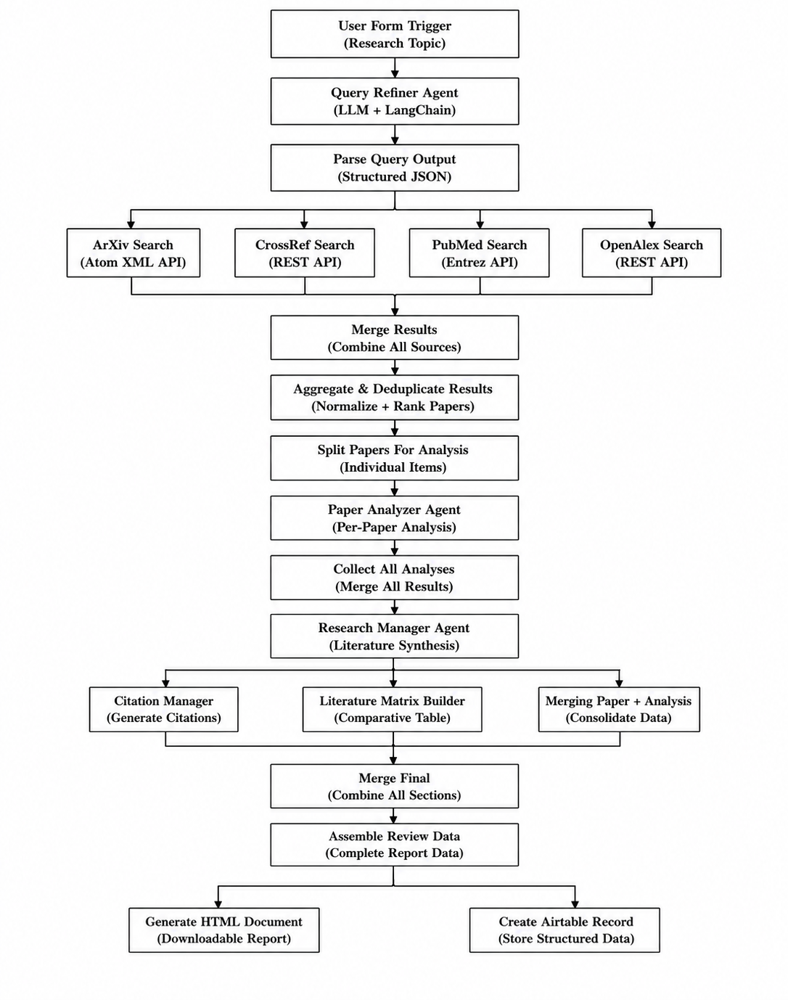
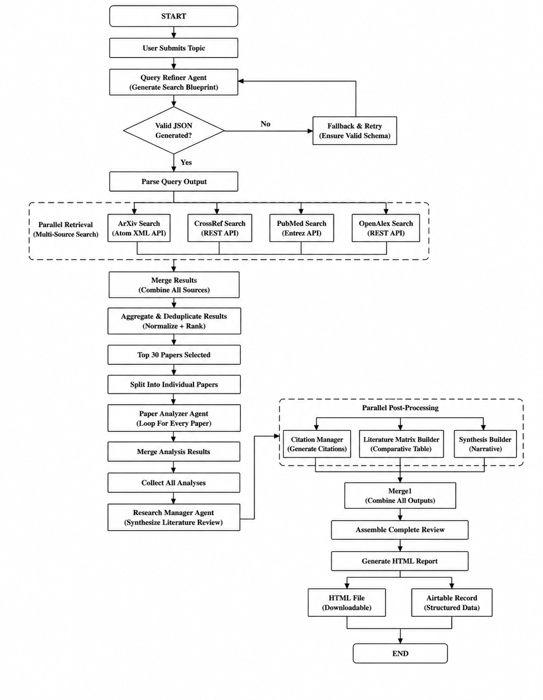
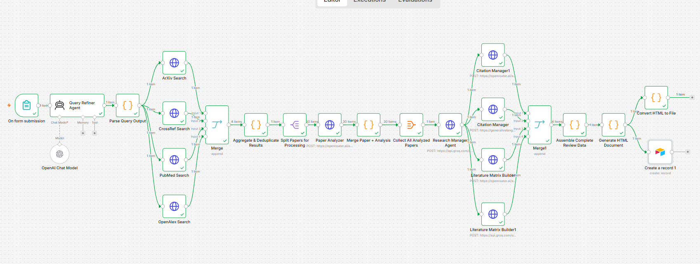
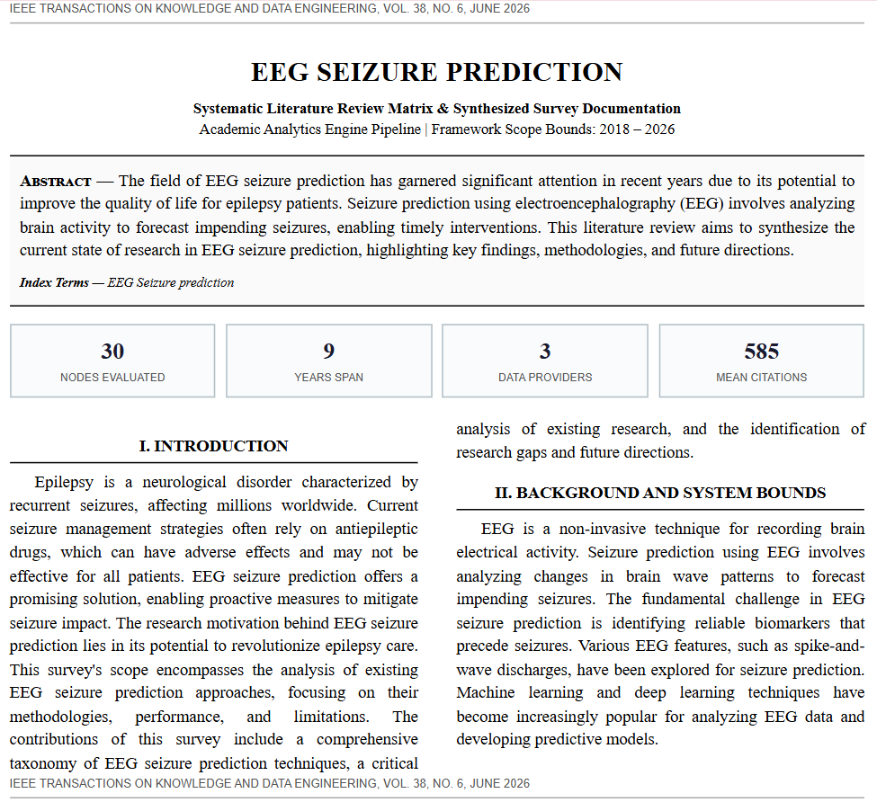
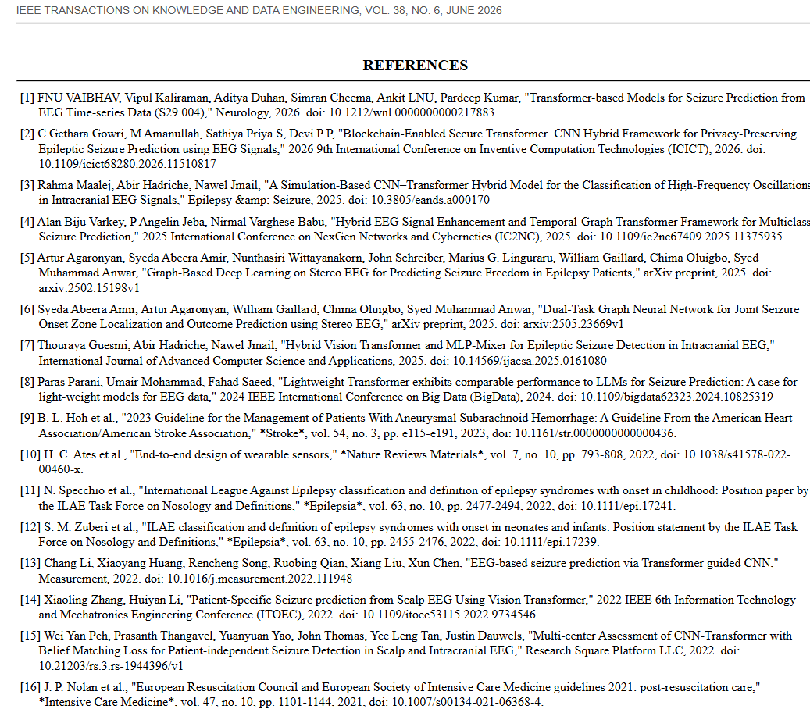

# Agentic Literature Survey Workflow

An AI-powered multi-agent literature survey workflow built using n8n that automates academic paper retrieval, analysis, citation generation, and literature review synthesis using multiple scholarly databases and Large Language Models (LLMs).


## Overview

Conducting a literature survey manually requires searching multiple databases, identifying relevant papers, analyzing abstracts, generating citations, comparing methodologies, and synthesizing findings into a structured review.

This project automates the entire process through an agentic AI workflow developed in n8n. The workflow retrieves papers from multiple academic sources, analyzes them using AI agents, generates citations and literature matrices, and produces a complete literature review report.


## Features

- Automated literature survey generation
- AI-powered query refinement
- Multi-source academic paper retrieval
- Research paper deduplication
- Individual paper analysis
- Literature synthesis using LLMs
- Automatic citation generation
- Comparative literature matrix creation
- HTML report generation
- Airtable integration for result storage


## System Architecture

The workflow consists of multiple specialized agents and processing modules:

### Query Refiner Agent
Generates optimized academic search queries from a user-provided research topic.

### Retrieval Layer
Retrieves papers from:

- ArXiv
- CrossRef
- PubMed
- OpenAlex

### Aggregation and Deduplication Module
Normalizes metadata and removes duplicate papers.

### Paper Analyzer Agent
Extracts:

- Research methodology
- Key findings
- Datasets used
- Evaluation metrics
- Research gaps

### Research Manager Agent
Synthesizes all analyzed papers into a comprehensive literature review.

### Citation Manager
Generates IEEE-style references.

### Literature Matrix Builder
Creates comparative analysis tables across selected papers.

### Report Generator
Produces a complete HTML literature review document.


## Workflow Architecture

<p align="center">
  
</p>


## Agent Interaction Flowchart

<p align="center">
  
</p>


## Workflow Pipeline

1. User submits a research topic.
2. Query Refiner Agent generates optimized search queries.
3. Multiple academic databases are queried in parallel.
4. Retrieved papers are merged and deduplicated.
5. Top-ranked papers are selected.
6. Each paper is analyzed independently.
7. Research Manager Agent synthesizes findings.
8. Citation Manager generates references.
9. Literature Matrix Builder creates comparison tables.
10. Final review document is generated and stored.


## Technology Stack

### Workflow Automation
- n8n

### AI Services
- OpenRouter
- Gemini
- Large Language Models (LLMs)

### Academic Databases
- ArXiv API
- CrossRef API
- PubMed API
- OpenAlex API

### Storage
- Airtable

### Programming Components
- JavaScript
- JSON
- REST APIs


## Repository Structure

```text
agentic-literature-survey-workflow/
│
├── README.md
├── Agentic  Literature Survey Workflow.json
│
├── docs/
│   ├── Project_Report.pdf
│   ├── High-Level_Block_Diagram.png
│   ├── Agent_Interaction_Flowchart.png
│
├── screenshots/
│   ├── workflow_n8n.png
│   ├── generated outputs
|    .....

```


## Installation

### Prerequisites

- n8n
- OpenRouter API Key
- Gemini API Key
- Airtable Account

### Import Workflow

1. Clone the repository.

```bash
git clone https://github.com/nidhi-shree/agentic-literature-survey-workflow.git
```

2. Open n8n.

3. Import `Agentic Literature Survey Workflow.json`.

4. Configure API credentials.

5. Activate the workflow.

6. Execute the workflow.


## Configuration

### OpenRouter

Configure:

- API Key
- Preferred LLM

### Gemini

Configure:

- Gemini API Key

### Airtable

Configure:

- Base ID
- Table Name
- Personal Access Token


## Input Example

```text
EEG Seizure Prediction using Deep Learning
```


## Output

The workflow generates:

### Literature Review Report

Includes:

- Executive Summary
- Introduction
- Background
- Thematic Analysis
- Research Gaps
- Future Directions
- Conclusion

### Citation List

Automatically generated IEEE-style references.

### Literature Matrix

Comparative analysis of selected papers.

### Airtable Dataset

Structured storage of processed papers and generated review data.


## Screenshots

### n8n Workflow Canvas

<p align="center">
  
</p>

### Generated Literature Review

<p align="center">
  
</p>

### Literature Review References Output

<p align="center">
  
</p>


## Advantages

- Reduces manual literature review effort
- Retrieves papers from multiple sources
- Generates structured analysis automatically
- Produces explainable outputs
- Easily extensible and reusable
- Supports academic research workflows


## Future Enhancements

- Semantic search integration
- Full-text PDF analysis
- Vector database support
- Knowledge graph generation
- PDF report export
- Interactive dashboard
- Research trend visualization


## Author

**Nidhishree N**

---

